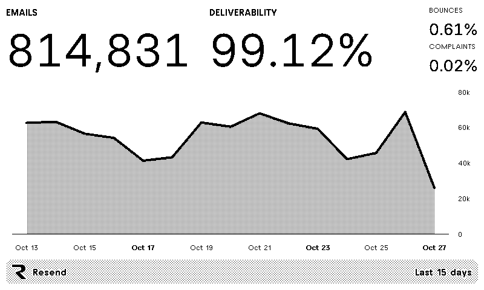
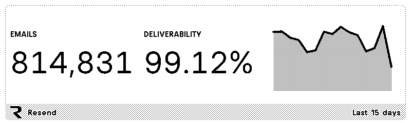
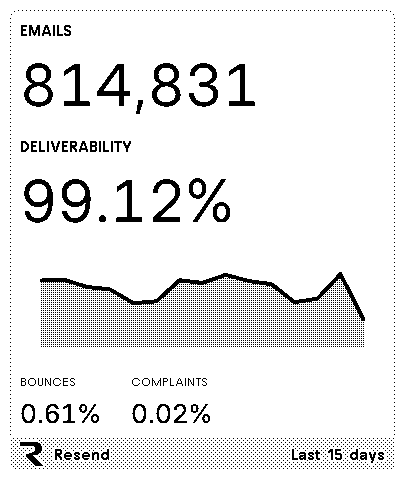
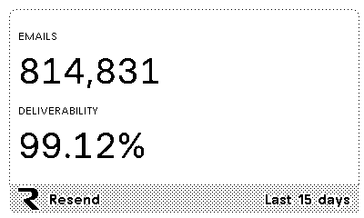

# Resend for TRMNL

The official [Resend](https://resend.com) plugin for [TRMNL](https://trmnl.com) e-ink displays.

See your email volume and deliverability at a glance, the same numbers as your Resend [metrics dashboard](https://resend.com/metrics).



## What it shows

Data covers the last 15 days, the same default range as the Resend dashboard, and refreshes every 15 minutes.

- **Emails**: emails sent
- **Deliverability**: share of sent emails that the recipient's mail server accepted
- **Bounces**: share of sent emails that bounced
- **Complaints**: share of delivered emails marked as spam
- **Chart**: emails sent per day, in your TRMNL time zone

## Layouts

The plugin adapts to every TRMNL layout, so it works on its own or in a mashup with other plugins.

### Full


### Half horizontal



### Half vertical



### Quadrant



## Setup

1. In TRMNL, add the Resend plugin and click **Connect**.
2. Sign in to Resend and approve access for your team.
3. Add the plugin to a playlist.

If access is revoked or expires, the screen shows "Couldn't load metrics" with the error from Resend.

## Development

The plugin is built with [trmnlp](https://github.com/usetrmnl/trmnlp), TRMNL's local preview server. You need [Docker](https://docs.docker.com/get-docker/).

```
src/
├── settings.yml            # polling URL, OAuth and settings fields
├── transform.js            # reshapes the Metrics API response for the views
├── shared.liquid           # title bar, error state and chart, shared by all views
├── full.liquid
├── half_horizontal.liquid
├── half_vertical.liquid
└── quadrant.liquid
```

To preview against your own account, put the OAuth client credentials in `.env` (gitignored). The client needs `http://localhost:4567/oauth/callback` as a redirect URI.

```sh
cat > .env <<'EOF'
TRMNL_OAUTH_CLIENT_ID=your-client-id
TRMNL_OAUTH_CLIENT_SECRET=your-client-secret
EOF

docker run --rm -p 4567:4567 --env-file .env -v "$(pwd):/plugin" trmnl/trmnlp serve
```

Then open [localhost:4567](http://localhost:4567) and click **Connect account**.

To regenerate the images in this README from sample data, run:

```sh
bin/previews
```

Lint with `bin/trmnlp lint`.

## License

[MIT](LICENSE)
